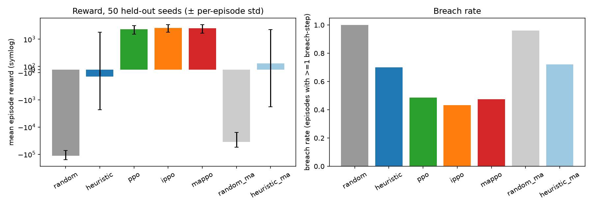
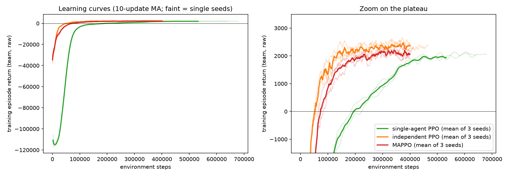
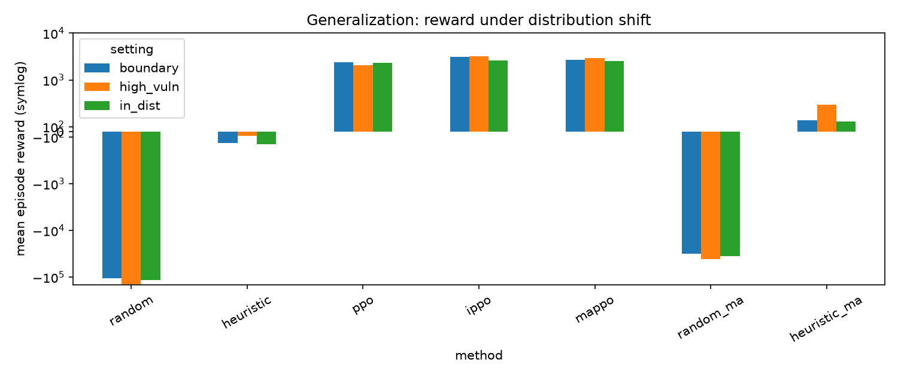
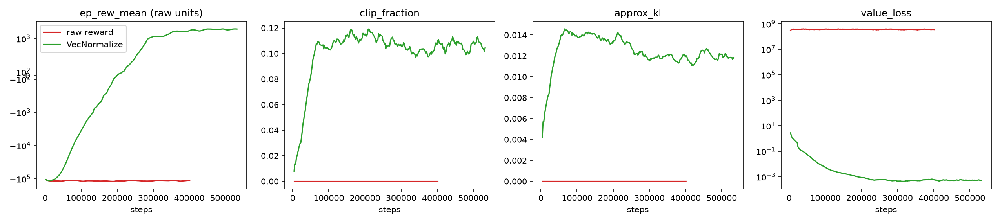
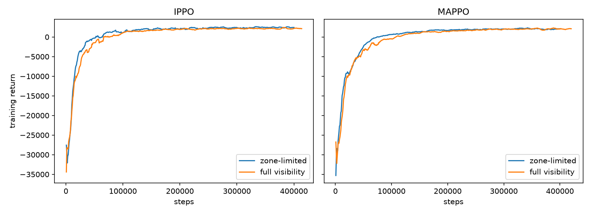

# Autonomous Cyber Defense Using Multi-Agent Reinforcement Learning

## Abstract
We build a stochastic, partially observable enterprise-network defense simulator (8 hosts, 5 host types, 5 attack
types, 4 compromise stages, 7 defensive actions) in single-agent (Gymnasium) and zone-partitioned multi-agent
(PettingZoo) form, and compare random, a tuned rule-based heuristic, single-agent PPO, independent PPO (IPPO) and
MAPPO over 50 held-out seeds, plus two distribution shifts. All learned methods beat the heuristic by a wide margin
in reward and breach rate in *this* simulator (e.g. PPO +2,336 vs heuristic −237). This **does not reproduce** the
CAGE-Challenge-4 finding that engineered heuristics beat submitted MARL agents; we discuss why (§8). Among learned
methods, differences are small: IPPO ≥ MAPPO ≳ PPO, with MAPPO *not* better than IPPO. Two ablations show that
(A) reward normalization is essential (raw −500/step rewards stall PPO completely) and (B) full network visibility
did **not** help over zone-limited observation (it was slightly worse), so this environment gives little empirical
motivation for coordination. A real-data replay on CICIDS2017 flows shows a large sim-to-real gap (policy F1 0.43 vs.
heuristic 0.68). The replay is an offline analysis, not a deployment claim.

## 1. Introduction / Motivation
Network defense is sequential, partially observable and adversarial; defenders see noisy alerts, not ground truth,
and must trade containment against downtime. RL promises adaptive policies; multi-agent RL additionally models
distributed defenders (per network segment) with limited visibility. We ask: in a controlled simulator, do
(i) learned policies beat a competitive heuristic, (ii) does coordinated training (MAPPO) beat independent learning,
(iii) do they generalize, and (iv) what happens when the policy meets real traffic features?

## 2. Related Work
**CybORG** (Standen et al., 2021) is a gym for autonomous cyber operations with simulation and emulation back-ends, built
to narrow the "reality gap" between simulated and real systems. The **CAGE Challenges** (TTCP CAGE Working Group) build on
it: CAGE-2 targets a single-agent defender on an enterprise network against scripted red agents, and CAGE-4 is the first
multi-agent variant, in which several cooperating blue agents defend different sub-networks against a persistent red
process. Secondary literature describing the CAGE-4 evaluation reports that carefully engineered heuristic defenders
outperformed the multi-agent RL agents that were submitted, attributing this to valid-action handling, event filtering and
selective use of restore/remove actions that reward-only MARL agents did not learn reliably [4]. We cite this as motivation
and note that we could not retrieve the official TTCP report, so the claim should be checked against that primary source.
We did not run CybORG: our simulator is a much simpler, independent design, so our numbers are **not comparable** to CAGE
scores. For learning, we use PPO (Schulman et al., 2017) with generalized advantage estimation (Schulman et al., 2016),
independent PPO (de Witt et al., 2020) and MAPPO (Yu et al., 2022) with a centralized critic. Rosay et al. (2022) document
labeling and feature-extraction problems in CICIDS2017, which is a further reason to read our real-data results (§7) as a
coarse gap analysis only.

## 3. Environment & Problem Formulation
Code: `env/core.py` (shared by both env wrappers, so dynamics and reward constants are identical).

* **Hosts** (default 8): zones DMZ = {server, cloud, server}, internal = {workstation, workstation, IoT}, data tier =
  {database, database}.
* **Stages**: UNCOMPROMISED → EARLY_INTRUSION → ESCALATED → BREACHED. Landing (initial access: malware, phishing, DDoS)
  has probability `vector_base × vuln × patch factor(0.5 if patched) × zone pressure`, reduced by `block_ip` (×0.25) and
  `redirect_traffic` (×0.6, ×0.1 for DDoS). Progression EARLY→ESCALATED (privilege escalation) and ESCALATED→BREACHED
  (data theft) have per-step base probabilities 0.30 / 0.25 scaled by vulnerability, patch status, vector and host type;
  isolation freezes progression; honeypots slow it ×0.8.
* **Cross-zone effect**: each un-isolated host at stage ≥ ESCALATED in zone *z* multiplies intrusion probability in zone
  *z+1* by +0.6 (capped at two hosts) on the next step (DMZ → internal → data tier).
* **Observation (POMDP)** per host: type one-hot, traffic-anomaly, user-anomaly (noisy, EMA-smoothed; noise σ = 0.22,
  4 % false-alarm spikes), vulnerability, patched, isolated, honeypot flags; plus a noisy global threat scalar. The true
  stage is never observed.
* **Actions** (one (host, action) pair per agent per step): no_op, block_ip (reverts EARLY w.p. 0.7, ESCALATED→EARLY
  w.p. 0.3), isolate_machine (5-step freeze, downtime), patch_system (vuln ×0.6, patched), redirect_traffic (scrubbing
  window; strong vs DDoS), deploy_honeypot (20-step decoy, max 3 active; traps 80 % of landings on it), restore_backup
  (clean + un-isolate, brief downtime).
* **Reward**: +100 attack reversed before breach; +50 early detection (first relevant action on an EARLY/ESCALATED host,
  or honeypot trap); −500 per breached host per step; −200 isolate; −1 per non-no-op action. **Design choice not in the
  spec:** `restore_backup` also costs −50 (brief outage), otherwise it would be free.
* **Multi-agent**: 3 zone agents, each with its own zone's host features (padded) plus shared `[threat, cross-zone alert
  fraction]`. Per-agent reward = components attributed to its zone; team reward = sum. `state()` exposes a privileged
  global state (including true stages) used only by MAPPO's critic. Episodes are 100 steps.

**Calibration note.** Parameters were chosen so that no-op and random are catastrophic and a tuned heuristic is strong,
before any learning (initial attempts were far too easy: heuristic ≈ 0.5 breach-steps/episode). We did *not* tune the
simulator to favour or handicap RL.

## 4. Methods
* **Heuristic** (`agents/heuristic.py`): from the smoothed anomaly score infer stage by thresholds → restore / isolate
  (then restore once isolated) / block_ip / patch / no_op; highest-priority host per step. Thresholds were grid-searched
  on tuning seeds (+284 on tuning seeds vs −2,735 untuned); held-out reward is lower (−237), i.e. mild overfitting to the
  20 tuning seeds is visible.
* **PPO** (SB3, MLP 128×128, 8 envs, VecNormalize on observations and rewards).
* **IPPO**: one actor + one critic per zone agent on local observation and zone-local reward; no sharing.
* **MAPPO**: one actor per zone (no parameter sharing), one shared centralized critic on the privileged global state,
  team reward. Custom implementation (sb3-contrib has none); same hyper-parameters, GAE(0.95), clip 0.2, entropy 0.01,
  running-return reward scaling as IPPO.
* **Stopping**: plateau rule (no >1 % improvement of the 10-update moving average for 40 updates, min 400k steps).

## 5. Experimental Setup
3 training seeds per learned method; 50 held-out evaluation seeds (10,000,000 + k), identical for all methods; trained
policies act greedily. Shifts: `high_vuln` (+0.20 base vulnerability on all hosts) and `boundary` (attackers
concentrate on each zone's gateway host and attack it more effectively; the exact "zone-boundary blind spot"). Metrics:
reward, breach rate (episodes with ≥1 breach-step), TTD (landing → first relevant action), TTC (detection → host clean),
downtime cost (|isolate| + |restore| penalties). **Fairness:** the MARL methods get 3 actions/step (one per zone), the
single-agent methods get 1, so we add capacity-matched *random (3/step)* and *heuristic (per zone, 3/step)* reference rows.

## 6. Results
### 6.1 Sanity (20 episodes, seeds 20000–20019)
| policy | mean reward | std | breach-steps/ep |
|---|---|---|---|
| no_op | −267,450 | 24,909 | 534.9 |
| random | −126,674 | 30,621 | 247.3 |
| heuristic | +414 | 1,255 | 2.2 |

### 6.2 Main comparison (50 held-out seeds; learned rows pool 3 training seeds = 150 episodes)
| method | act/step | reward mean | per-episode std | across-train-seed std | breach rate | breach-steps | TTD | detect rate | TTC | contain rate | downtime cost |
|---|---|---|---|---|---|---|---|---|---|---|---|
| random | 1 | −114,204 | 40,933 | – | 1.00 | 222.4 | 12.1 | 0.91 | 13.9 | 0.71 | 3,603 |
| heuristic | 1 | −237 | 2,067 | – | 0.70 | 3.2 | 2.3 | 0.99 | 1.7 | 0.98 | 769 |
| PPO | 1 | 2,336 | 826 | 71 | 0.49 | 0.81 | 2.0 | 0.98 | 0.07 | 1.00 | 1,617 |
| independent PPO | 3 | 2,617 | 802 | 160 | 0.43 | 0.57 | 1.6 | 0.98 | 0.28 | 1.00 | 1,321 |
| MAPPO | 3 | 2,522 | 875 | 288 | 0.47 | 0.72 | 2.0 | 0.98 | 0.20 | 1.00 | 1,194 |
| *random (3/step)* | 3 | −34,882 | 19,337 | – | 0.96 | 51.9 | 4.7 | 0.97 | 8.9 | 0.89 | 9,569 |
| *heuristic (3/step)* | 3 | 202 | 2,032 | – | 0.72 | 2.6 | 2.0 | 0.97 | 1.5 | 0.98 | 623 |

(`results/comparison_table.csv`, `results/fig_comparison.png`, `results/fig_learning_curves.png`.)

Paired tests over the 50 shared seeds (`results/paired_tests.csv`; these capture evaluation-episode noise for the 3
trained models, not training-seed variance): learned ≫ heuristic (p < 1e-9). IPPO − PPO = +281 ± 184 (p = 0.004);
MAPPO − PPO = +186 ± 192 (p = 0.06); **MAPPO − IPPO = −95 ± 169 (p = 0.27, not significant)**. With only 3 training
seeds and a seed-to-seed std of 160–290, the ordering among learned methods is weak evidence; IPPO/MAPPO vs PPO is also
confounded by the 3× action capacity.

Interpretive notes. (i) TTC is near zero for learned policies because `restore_backup` detects and cleans in the same
step; the heuristic first isolates then restores. (ii) Breach rate is high for every method (0.43–0.70) but breach-steps
are tiny (<1 for learned): occasional brief breaches are tolerated because rewards for early detection/prevention
outweigh the cost. (iii) **Reward is not monotone in security**: reward *rises* under `high_vuln` for the learned
methods because +50/+100 events scale with attack volume — breach rate is the better security metric.
(iv) Deployed learned policies take ~90–150 actions/episode (heuristic ≈ 63), i.e. they are action-hungry (cost: −1 each).

### 6.3 Generalization (never seen in training; mean reward | breach rate)
| method | in-dist | high_vuln (+0.2) | boundary-targeted |
|---|---|---|---|
| random | −114,204 \| 1.00 | −139,307 \| 1.00 | −106,518 \| 1.00 |
| heuristic | −237 \| 0.70 | −82 \| 0.80 | −215 \| 0.76 |
| PPO | 2,336 \| 0.49 | 2,033 \| 0.79 | 2,365 \| 0.63 |
| IPPO | 2,617 \| 0.43 | 3,165 \| 0.59 | 3,084 \| 0.33 |
| MAPPO | 2,522 \| 0.47 | 2,929 \| 0.73 | 2,665 \| 0.54 |
| random (3/step) | −34,882 \| 0.96 | −41,258 \| 0.98 | −31,147 \| 0.94 |
| heuristic (3/step) | 202 \| 0.72 | 528 \| 0.64 | 222 \| 0.76 |

Learned policies keep their reward advantage under both shifts, and PPO's breach rate degrades most under `high_vuln`
(0.49 → 0.79). The 3-action methods look *better* under the boundary shift in reward and breach rate, largely because
the shift concentrates attacks on 2 hosts that those agents can cover simultaneously; we did not isolate this further.
Per-training-seed variation is large under shift (e.g. PPO seed 1 under `high_vuln`: 975 vs 2,756 for seed 2).

### 6.4 Adaptive red agent (extra generalization test, never seen in training)
A hand-written, **rule-based** reactive attacker (`attack_profile="adaptive"` in `env/core.py`): it prefers weak hosts, avoids
hosts that are blocked/redirected/isolated and (mostly) honeypot decoys, follows footholds into the next zone, and favours
databases. It is not learned. 50 held-out seeds, same protocol as §6.2:

| method | act/step | reward (in-dist → adaptive) | breach rate (adaptive) | breach-steps |
|---|---|---|---|---|
| random | 1 | −114,204 → −192,555 | 1.00 | 379.7 |
| heuristic | 1 | −237 → −2,240 | 0.98 | 7.7 |
| PPO | 1 | 2,336 → 796 | 0.89 | 4.5 |
| independent PPO | 3 | 2,617 → 2,640 | 0.68 | 1.5 |
| MAPPO | 3 | 2,522 → 2,345 | 0.81 | 1.8 |
| *heuristic (3/step)* | 3 | 202 → −217 | 0.92 | 4.5 |

Every method degrades; the single-action methods degrade most (PPO −1,540 reward, breach rate 0.49 → 0.89). The 3-action
methods lose little reward, but their breach rates still rise substantially (IPPO 0.43 → 0.68, MAPPO 0.47 → 0.81).
A large part of the trained policies' advantage is honeypot trapping, which the adaptive attacker partly defeats. Caveat:
the adaptive attacker was written after seeing the trained policies' behaviour, so it is a stress test, not a neutral
held-out adversary. `showcase/demo.html` replays real episodes of these matchups with step-by-step explanations.

## 7. Real-Data Validation (CICIDS2017) — offline sim-to-real gap analysis, NOT a deployment claim
**Data.** `MachineLearningCSV.zip` (235 MB; downloaded from the Hugging Face mirror `bencorn/CICIDS2017`, a third-party
copy of the UNB release; not hash-verified against UNB). We drew a stratified labeled subset of 24,720 flows (9,000
benign; ≤1,500 per attack class; all rows of rare classes) — `data/cicids_subset.csv`.
**Mapping** (`data/cicids_loader.py`). `traffic_anom` from benign-ECDF deviation of {duration, packets, bytes, bytes/s,
packets/s, SYN/RST/FIN counts}; `user_anom` from {IAT mean, idle mean, down/up ratio, PSH/ACK counts, init window,
avg packet size, fwd packet length}; both rescaled so benign median → 0.10 and benign p95 → 0.45 (calibrated on
benign flows only). Labels → stages (assumption): PortScan/Bot/Web attacks → EARLY; FTP/SSH-Patator/Infiltration →
ESCALATED; DoS*/DDoS/Heartbleed → BREACHED. The anomaly proxies are weak: mean traffic_anom is 0.15 benign vs
0.23/0.24/0.31 for stages 1/2/3 (stdev ≈ 0.1–0.16), so class separation is poor *by construction of the proxy*.
**Replay.** Each of the 8 host slots receives contiguous label-homogeneous segments (10–30 steps, 60 % benign) of real
flows, EMA-smoothed like the simulator; 2,000 steps × 8 hosts = 16,000 host-steps. Vulnerability fixed at 0.5, no
patch/isolation/honeypot state. The frozen policy's *implied response per host* = argmax of that host's 7 action logits.
No retraining, no actions executed.

Best trained policy by held-out reward = `mappo_s2`. Ground-truth stage (rows) × implied action (columns), counts:

| stage \ action | no_op | block_ip | isolate | patch | redirect | honeypot | restore |
|---|---|---|---|---|---|---|---|
| UNCOMPROMISED | 2694 | 1056 | 0 | 27 | 1361 | 4461 | 274 |
| EARLY_INTRUSION | 411 | 204 | 0 | 1 | 316 | 807 | 231 |
| ESCALATED | 234 | 65 | 1 | 8 | 149 | 731 | 242 |
| BREACHED | 427 | 201 | 2 | 0 | 382 | 1069 | 646 |

Binary "active response (block/isolate/redirect/restore) vs attack-present": MAPPO policy TP 2439, FP 2691, FN 3688,
TN 7182 → precision 0.475, recall 0.398, **F1 0.433**, false-alarm rate 0.273. The SB3 PPO (`ppo_norm_s0`) policy:
precision 0.513, recall 0.764, F1 0.614, FAR 0.451. The simulator-tuned heuristic applied to the same features:
precision 0.808, recall 0.585, **F1 0.679**, FAR 0.086. Recall by true stage (MAPPO): 0.38 / 0.32 / 0.45 for
EARLY / ESCALATED / BREACHED.

**Findings.** (1) The policy's response is nearly independent of ground-truth stage (e.g. benign flows trigger an active
response 27 % of the time vs 32–45 % for attack stages) — it did not transfer the discrimination it shows in simulation.
(2) The policy relies heavily on `deploy_honeypot` (a cheap action in the sim) regardless of stage, an artefact of the
simulator's cost structure. (3) The heuristic, whose thresholds are explicit, transfers better — but its replay row also shows an
artefact (it "patches" every quiet host because replay fixes vulnerability = 0.5). (4) Caveats that limit any
conclusion: proxy features are weak, the stage mapping is an assumption, there is no temporal attack-chain structure in the
replay, and no response feedback. This table quantifies a *gap*; it says nothing about operational performance.

## 8. Ablations
**A. Reward scale** (single-agent PPO, seed 0, identical hyper-parameters):
| config | steps | final train ep_rew | clip_fraction | approx_kl | explained var | value_loss | held-out reward | breach rate |
|---|---|---|---|---|---|---|---|---|
| raw reward | 401k | −111,756 | 0.000 | ~0 | 0.000 | 3.7e8 | −202,442 | 1.00 |
| VecNormalize | 532k | +1,951 | 0.103 | 0.013 | 0.20 | 0.024 | +2,265 | 0.54 |

The raw run shows exactly the predicted pathology (flat `ep_rew_mean`, zero clip fraction / KL, exploding value loss)
and ends *worse than random* on held-out seeds (−202k vs −114k). It "plateaued" only in the trivial sense that the
stopping rule fired at the 400k minimum; `results/fig_ablation_reward_scale.png`.

**B. Observation design** (IPPO / MAPPO, 3 training seeds each, 50 held-out seeds):
| config | reward | across-seed std | breach rate | breach-steps |
|---|---|---|---|---|
| IPPO zone-limited | 2,617 | 160 | 0.43 | 0.57 |
| IPPO full visibility | 2,454 | 168 | 0.53 | 0.80 |
| MAPPO zone-limited | 2,522 | 288 | 0.47 | 0.72 |
| MAPPO full visibility | 2,389 | 382 | 0.52 | 0.79 |

Full visibility is **not** better; differences (−130 to −160) are within seed-to-seed std. In this simulator the cost of
partial observability is therefore ≈ 0, and the ablation gives no empirical support for needing coordination (larger
inputs may even slow learning). Possible reasons: cross-zone coupling is weak (+0.6 per escalated host in the preceding zone) and
each zone can be defended largely from local signals.

## 9. Discussion & Limitations
* **Learned > heuristic here, unlike CAGE-4.** Likely causes: our heuristic uses only one global rule set with a handful
  of thresholds and one action per step; the simulator is stationary and stochastic but not adversarially adaptive (the
  attacker is a fixed stochastic process), so a learner can exploit its statistics and its reward structure (e.g. positive
  reward for detection/prevention, cheap honeypots/redirects). In CAGE-4 the attacker, network and observation spaces were
  far richer and the heuristics were hand-engineered by domain experts. We therefore **do not** claim RL beats heuristics in
  general; we claim it does in this simulator, and that the real-data replay shows the advantage does not transfer.
* **MAPPO did not beat independent PPO** (−95 ± 169, p = 0.27). We report this plainly: coordinated training with a
  privileged centralized critic gave no measurable benefit, consistent with the ablation that finds weak coordination demand.
* **Reward hackability / non-monotonicity**: reward grows with attack volume (§6.2), so reward alone is a poor security
  metric; the −200 isolation cost makes learned policies avoid isolation (≈0 isolate actions in replay).
* **Sim-to-real gap** (§7), **non-stationarity** (in MARL each agent's environment changes as the others learn; our attacker
  is stationary, so the true difficulty of non-stationarity is understated), and **small scale** (8 hosts, 100-step episodes,
  3 training seeds, minimum-length plateau stopping: several MARL runs stopped at exactly the 400k floor, meaning the curves
  had already flattened, but longer runs were not tried).
* Capacity confound: MARL = 3 actions/step; the capacity-matched heuristic (+202) shows the extra capacity alone does not
  explain the gap between learned and heuristic policies.
* The heuristic was tuned on 20 seeds; a better-tuned or learned-threshold heuristic might close part of the gap.

## 10. Conclusion & Future Work
In a custom partially observable cyber-defense simulator, normalized-reward PPO variants clearly beat random and a tuned
heuristic, IPPO ≈ MAPPO ≳ PPO, and the advantage survives vulnerability and boundary-targeting shifts; but
reward normalization is mandatory, MAPPO's centralized critic and full visibility gave no benefit, and the policies show a
large sim-to-real gap on CICIDS2017 flows. Future work: adaptive (learning) attackers and self-play; recurrent policies for
the POMDP; richer cross-zone coupling where coordination should matter; multi-day temporal replay with realistic attack chains;
reward redesign to remove the attack-volume incentive; replicating in CybORG/CAGE-4 directly.

## 11. References
1. M. Standen, M. Lucas, D. Bowman, T. J. Richer, J. Kim, D. Marriott. CybORG: A Gym for the Development of Autonomous Cyber Agents. arXiv:2108.09118, 2021.
2. TTCP CAGE Working Group. Cyber Autonomy Gym for Experimentation (CAGE) Challenges, including CAGE Challenge 4. (Primary report not retrieved; see note in §2.)
3. J. Schulman, F. Wolski, P. Dhariwal, A. Radford, O. Klimov. Proximal Policy Optimization Algorithms. arXiv:1707.06347, 2017.
4. Secondary description of the CAGE-4 evaluation outcome: Safety-Contract Graph Multi-Agent Reinforcement Learning for Autonomous Network Security Response. arXiv:2606.13832.
5. J. Schulman, P. Moritz, S. Levine, M. Jordan, P. Abbeel. High-Dimensional Continuous Control Using Generalized Advantage Estimation. arXiv:1506.02438, 2016.
6. C. Schroeder de Witt et al. Is Independent Learning All You Need in the StarCraft Multi-Agent Challenge? arXiv:2011.09533, 2020.
7. C. Yu et al. The Surprising Effectiveness of PPO in Cooperative Multi-Agent Games. NeurIPS Datasets and Benchmarks, 2022.
8. A. Raffin et al. Stable-Baselines3: Reliable Reinforcement Learning Implementations. Journal of Machine Learning Research 22(268), 2021.
9. M. Towers et al. Gymnasium: A Standard Interface for Reinforcement Learning Environments. arXiv:2407.17032, 2024.
10. J. Terry et al. PettingZoo: Gym for Multi-Agent Reinforcement Learning. NeurIPS, 2021.
11. I. Sharafaldin, A. H. Lashkari, A. A. Ghorbani. Toward Generating a New Intrusion Detection Dataset and Intrusion Traffic Characterization. ICISSP, 2018 (CICIDS2017).
12. A. Rosay, E. Cheval, F. Carlier, P. Leroux. Network Intrusion Detection: A Comprehensive Analysis of CIC-IDS2017. ICISSP, 2022.

Note: bibliographic details above were assembled from memory and partial web lookups (items 1, 4 confirmed by search); check each entry against the source before final submission.

## Appendix A. Acceptance checklist
- [x] Single-agent env, heuristic, PPO run with sensible numbers; heuristic ≫ random (+414 vs −126,674 in sanity; −237 vs −114,204 held-out).
- [x] Multi-agent env runs end-to-end with IPPO and MAPPO (PettingZoo `parallel_api_test` passes).
- [x] 5 methods × 5 metrics table (+2 capacity-matched references).
- [x] Generalization numbers for every method (two shifts).
- [x] Real-data confusion-style table (§7).
- [x] Both ablations with explicit numbers (§8).
- [x] README with commands, versions, seeds.
- [x] Honest reporting: learned methods beat the heuristic here (diverging from CAGE-4); MAPPO ≯ IPPO.

